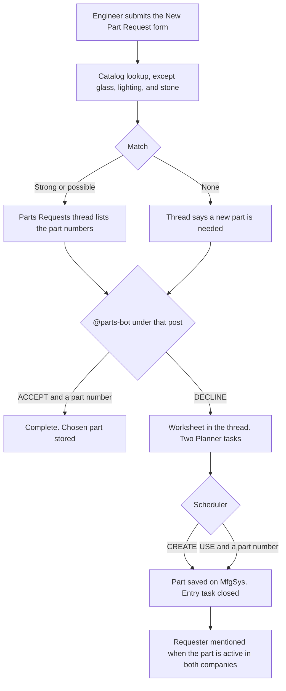

# Part Requests

Global material lookups and new part creation run through the **New Part Request** form and the **Parts Requests** channel in Teams. Submit the form, then answer under that post with `@parts-bot`.

> **Related**: [Engineer Guide](/tools/releases-and-requests/part-requests/engineer-guide.html) | [Scheduler Guide](/tools/releases-and-requests/part-requests/scheduler-guide.html) | [Part Management](/tools/epicor/part-management.html) | [Reverse Lookup](/workflows/fabrication-engineer/toolkit/modeling.html#how-to-reverse-lookup)

## Workflow Overview

Glass, lighting, and stone are not searched. Those posts go out as no match. Category **Unknown** stops before a post.

## Who Does What

| Role | Responsibilities |
|---|---|
| **Engineer** | Submits the form. Replies `@parts-bot ACCEPT` and a part number, or `@parts-bot DECLINE` |
| **Scheduler** | On a decline, `@parts-bot CREATE` saves the next part, or `@parts-bot USE` records one already in Epicor. Runs the site push-pull |

See the [Engineer Guide](/tools/releases-and-requests/part-requests/engineer-guide.html) or the [Scheduler Guide](/tools/releases-and-requests/part-requests/scheduler-guide.html).
