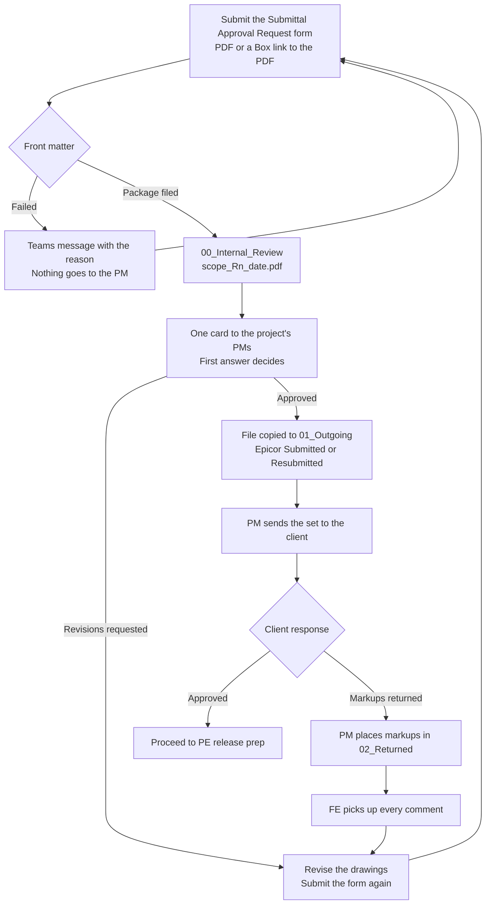

# Submittal Review Cycle

How a shop-drawing package is filed, approved, sent to the client, and revised. The [Submittal Approval](/tools/approvals-process.html) page is the project manager's side of the same card.

This page is the drawing-package review. The project's PMs answer one card after the form files the package, once for that issue, before the set goes to the client. Build strategy is reviewed earlier, with the Project Advisor, in the working session before modeling and with the lead as the approach is set. That sign-off is **PA Approved** on the [release checklist](/workflows/fe-to-pe-release.html#approval-prerequisites).

> **Related**: [Submittal Approval](/tools/approvals-process.html) | [FE to PE Release](/workflows/fe-to-pe-release.html) | [Folder Structure](/reference/folder-structure.html) | [Material Transmittal Log](/workflows/fabrication-engineer/material-transmittal.html)

## Overview

Completed shop drawings follow a three-folder workflow under `03_OUTGOING_Submittals/[scope]_[description]/`:

```
03_OUTGOING_Submittals/
  <scope>_<description>/
    00_Internal_Review/    ← The form files the review package here
    01_Outgoing/           ← The same file, copied here when a PM approves
    02_Returned/           ← Architect markups, placed by the PM
```

The scope folder is copied from the `_PROJ.JOB_ScopeDescription` template when it is missing. `03 Engineering` and `03_OUTGOING_Submittals` have to already exist. The project folder is the one under Awarded whose name starts with the project number.



## Step-by-Step

### 1. Submit the form
{: #how-to-submit-for-approval}

Open the **Submittal Approval Request** form in the Airtable base **Releases & Requests**.

1. Name the job, or the group, that this submittal covers. One submission is one package.
2. Attach the printed submittal PDF, or paste a Box link that opens that PDF. The form builds from that file. A link to a folder fails. The form does not search Box for a plot.
3. Type the revision. This is the client's revision. An internal reprint of the same issue stays at the same revision. Leave the revision blank for R0.

The project folder under Awarded, and `03 Engineering / 03_OUTGOING_Submittals` inside it, have to already exist. If either is missing, the build fails and nothing goes to the PM.

Finish, veneer, and general material on the package print from the project's [Material Transmittal Log](/workflows/fabrication-engineer/material-transmittal.html) as it stands when you submit. Confirm with the PM that the log is current before you submit.

### 2. Read the Teams message

Within a few minutes you get one message.

- **Ready.** The package was built and the PM's card follows. The message names the scope and revision, links the PDF, and lists what the drawing check found. Findings do not stop the request.
- **Failed.** Nothing went to the PM. The message says why. Check the PDF link or the job, then submit the form again. If it fails twice, ask Fernando Saucedo or Caleb Marhoover.

The finished package is a new file, `<scope>_R<revision>_<yyyyMMdd>.pdf`, in `00_Internal_Review`. Your original PDF stays where you attached it from. Submitting the same submittal again, at the same revision, replaces the package. The previous file moves to `ARCHIVE` under `00_Internal_Review`.

### 3. Wait for the PM

The project's PMs get one approval card. The first person to answer decides. Reminders go out on working days. The project's **General** channel gets a short notice that the request went out. A project whose name contains the word CMG does not get that notice. The card still goes to the PMs.

Answer on the card. A reply in the job's General thread leaves the card waiting.

### 4. Read the decision
{: #how-to-respond-to-denial}

- **Approved.** The same PDF is copied to `01_Outgoing`. Older files there move to `Archive`. The PM still sends the set to the client. If the review file has markups, a comment-free copy for the client is still the PM's to export.
- **Revisions requested.** Nothing is copied to `01_Outgoing`. The comments on the card are the instruction. Revise the drawings, then submit the form again. Do not reuse the rejected card.
- **Replaced.** A newer request for the same submittal went out. The earlier card no longer counts.

### 5. Epicor follows the request
{: #how-to-track-submittal-status}

You do not type drawing-package status on the Production Report. The flow writes it, and only these moves:

| Before | When the request goes out | When a PM approves |
|---|---|---|
| Blank, not submitted, or revise and resubmit | Internal Review | — |
| Blank, not submitted, or Internal Review | — | Submitted, and the date |
| Revise and resubmit | Internal Review | Resubmitted, and the date |
| Submitted, Resubmitted, Approved, or anything further along | Left as it is | Left as it is |

A rejection leaves Epicor as it is. A project whose name contains the word CMG is left unchanged either way. The write is on the company that owns the job, CWK Associates or Digifabshop. A job on any other company is left unchanged. The Teams message names the Epicor result only when a status was written.

The same field is visible on the [Submittal Dashboard](/tools/epicor/dashboards.html#submittal-dashboard). It tracks the drawing package as a whole. Material and finish approval is the [Material Transmittal Log](/workflows/fabrication-engineer/material-transmittal.html).

A filled transmittal draft for the PM is built and switched off. It does not change this form. The [Submittal Approval](/tools/approvals-process.html) page describes it.

### 6. Returned

When the architect returns marked-up drawings:

- The PM places them in `02_Returned`.
- You review every redline and incorporate the changes. See [Tracking Markup Pickup](#tracking-markup-pickup).
- If changes are required, submit the form again. Each client return that results in a reissue is one **revision**. Apply revision clouds, symbols, notes, and update the titleblock revision log. See [Revision History](/standards/rhino-drafting/revision-history.html).

### 7. The job thread

A parent job gets a thread in the project's General channel, separate from the approval card. The first reply names the Submittal engineer assigned to that job. If that engineer is you, you are @mentioned. A vendor assignment is named in plain text. Use the thread for questions about that job. The decision is the card.

## Tracking Markup Pickup
{: #tracking-markup-pickup}

When working through internal or external redlines, every comment must receive a visible disposition. Do not close the file once the changes are made. This applies to PM comments on the review file and to returned architect markups.

Each comment should be resolved in one of three ways:

- **Picked up** — change incorporated into the drawings
- **RFI** — insufficient information to act; flagged for clarification
- **Escalated to PM** — comment may warrant rejection or negotiation with the client

### Method 1: Highlighter

Use the Bluebeam highlighter to mark each comment on the page as it is addressed.

### Method 2: Markup Status (Markups List)

The Markups List pane in Bluebeam Revu includes a **Status** field for each annotation. Assigning a status creates a logged record of how each comment was handled.

| Status | Hotkey | Use |
|---|---|---|
| Accepted | `Shift+1` | Comment picked up and incorporated |
| Rejected | `Shift+2` | Comment rejected — escalate to PM |
| Cancelled | `Shift+3` | Comment no longer applicable |
| Completed | `Shift+4` | Action taken (broader than accepted) |
| None | `Shift+5` | Clear / reset status |

Either method is acceptable. Working through a redlined set with no tracking is not.

## RFIs — Requesting Information from the Architect
{: #rfis}

Information gaps that cannot be resolved from the contract documents go through the **RFI (Request for Information)** process:

1. **FE identifies the gap.** Document the question, the drawing reference, and what information is needed.
2. **Submit to the PM.** The PM writes, formats, and submits formal RFIs. Do not send a formal request to the architect yourself.
3. **The PM tracks and returns the answer.**

> All formal communication with the client or architect goes through the PM.

RFI status may be tracked in the Bluebeam markup log, as in [Tracking Markup Pickup](#tracking-markup-pickup).

## Scope Changes — PCO and Change Order Direction
{: #scope-changes}

When an architect's markup or other project development reveals work outside the contracted scope, the engineering team does not absorb that scope on its own.

1. **Flag it to the PM** when returned markups or other communications suggest a scope change.
2. **The PM evaluates and initiates a PCO** with the client when the item warrants one.
3. **The PM directs Engineering.** Proceed with the changed scope only after the PM issues CO scope or confirms the work is inside the original contract.

> Confirm with the PM before performing significant rework from returned markups.

## Key Principles

- **Submit the form.** The package, the card, the `01_Outgoing` copy, and the Epicor status follow from it.
- **The revision is the client's.** An internal reprint stays at the same revision.
- **Submit once.** A second form is a second request. If nothing arrives after a few minutes, ask Fernando Saucedo or Caleb Marhoover.
- **Findings do not block the PM.** They can approve with findings showing.
- **Pick up every comment** on the way back from a rejection or a client return.
- **Route RFIs through the PM.**
- **Confirm scope before acting.** Markups that look like a scope change need PM direction first.
