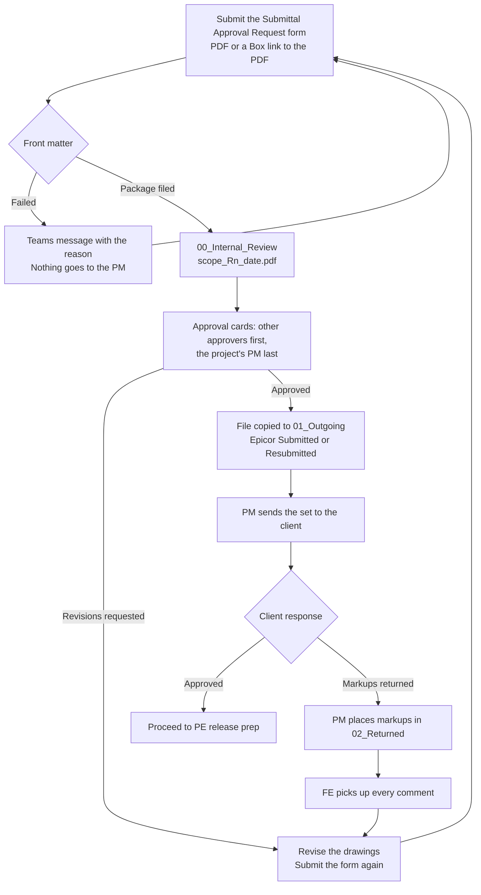

# Submittal Review Cycle

How a shop-drawing package is filed, approved, sent to the client, and revised. The [Submittal Approval](/tools/approvals-process.html) page is the project manager's side of the same card.

This page is the drawing-package review. After the form files the package, approval cards go out, once for that issue: other approvers named on the request sign first and the project's PM answers last, before the set goes to the client. Build strategy is reviewed earlier, with the Project Advisor, in the working session before modeling and with the lead as the approach is set. That sign-off is **PA Approved** on the [release checklist](/workflows/fe-to-pe-release.html#approval-prerequisites).

> **Related**: [Submittal Approval](/tools/approvals-process.html) | [FE to PE Release](/workflows/fe-to-pe-release.html) | [Folder Structure](/reference/folder-structure.html) | [Material Transmittal Log](/workflows/fabrication-engineer/material-transmittal.html)

## Overview

Completed shop drawings follow a three-folder workflow under `03_OUTGOING_Submittals/[scope]_[description]/`:

```
03_OUTGOING_Submittals/
  <scope>_<description>/
    00_Internal_Review/    ← The form files the review package here
    01_Outgoing/           ← The same file, copied here when a PM approves
    02_Returned/           ← Architect markups, placed by the PM
```

The scope folder is copied from the `_PROJ.JOB_ScopeDescription` template when it is missing. `03 Engineering` and `03_OUTGOING_Submittals` have to already exist. The project folder is the one under Awarded whose name starts with the project number.



## Step-by-Step

### 1. Submit the form
{: #how-to-submit-for-approval}

Open the [Submittal Approval Request form](https://airtable.com/app2X7JU998GzDUWj/pagn7ycolnWjLu5ra/form) in the Airtable base **Releases & Requests**.

1. Name the job, or the group, that this submittal covers. One submission is one package.
2. Attach the printed submittal PDF, or paste a Box link that opens that PDF. The form builds from that file. A link to a folder fails. The form does not search Box for a plot. Print the PDF from Rhino as a vector print with a text layer. The form reads each sheet's title block from that text, so a scanned or raster-only print can't be read.
3. Type the revision. This is the client's revision. An internal reprint of the same issue stays at the same revision. Leave the revision blank for R0. From revision 1 on, the form also asks for a **Revision note** (two lines).

The form has more fields, all optional. Choose **Grouped Submittal** and type the group code (for example `1162.GS.001`) when the package covers a group. Add **Approvers** to have other people sign before the PM. Other fields: **Project Image**, **BOM Exclusions** (hide manufactured, project-purchased, hardware, glass, or lighting parts from the G00 BOM), **Engineer initials** (blank takes initials from your name), **Title lines** 1 to 3, **Address** lines 1 to 3, **Architect**, **Production notes** (up to 10 lines), and **Sheet notes** (up to 16 lines). A value you type wins over the Projects table and Epicor, and the Projects table fills the architect, address, and T00 image when you leave them blank. The engineer initials and revision log still come from your title block.

The project folder under Awarded, and `03 Engineering / 03_OUTGOING_Submittals` inside it, have to already exist. If either is missing, the build fails and nothing goes to the PM.

Finish, veneer, and general material on the package print from the project's [Material Transmittal Log](/workflows/fabrication-engineer/material-transmittal.html) as it stands when you submit. Confirm with the PM that the log is current before you submit.

**What the form does with your print.** It does not use the front matter in your print. It builds a new C00, T00, and G00 from Epicor, dated the day the form runs, and puts them in front of your sheets. A C00, T00, or G00 already in the print is dropped. It reads the drawing number, sheet title, and issue date from each sheet's title block to build the index, and it takes your engineer initials and revision log from the title block too, so fill those in before you print. When the request leaves them blank, it also fills the client, architect, and address from the print's own cover sheets. Sketch pages (`SK##`) stay in the PDF but are left out of the index. In the finished PDF every index row and every sheet is a link or a bookmark.

### 2. Read the Teams message

Within a few minutes you get one message.

- **Ready.** The package was built and the PM's card follows. The message names the scope and revision, links the PDF, and lists what the drawing check found. Findings do not stop the request.
- **Failed.** Nothing went to the PM. The message says why. Check the PDF link or the job, then submit the form again. If it fails twice, ask Fernando Saucedo or Caleb Marhoover.

The finished package is a new file, `<scope>_R<revision>_<yyyyMMdd>.pdf`, in `00_Internal_Review`. Your original PDF stays where you attached it from. Submitting the same submittal again files a new package. The scope's earlier review files move to `ARCHIVE` under `00_Internal_Review`; other files there stay. Submitting twice on the same day at the same revision uploads a new version of the same file.

**What the drawing check looks at.** The message groups its findings under five headings, and each finding is an error, a warning, or a note. Findings never stop the request, but fix the errors before the PM sees the set.

| Heading | Errors | Warnings |
|---|---|---|
| Title blocks | The JOB # in a title block does not match the jobs in the submittal (a group's short form such as `1162.011, 013, 014` is accepted). No title block could be read, because the print has no text layer | Issue dates differ across the sheets. A sheet has no readable title block or drawing number. The drawing numbers use a different prefix from the scope |
| Tags and schedule | None | A material tag on a drawing is not in the Material Transmittal Log, or the log is empty. A part number called out on a drawing is not in the job's BOM, or the BOM is empty. The same schedule is entered in both companies. Two transmittal rows become the same tag after zero-padding, such as FN1 and FN01 |
| Callouts and references | A callout or SEE PAGE note names a sheet that is not in the package | A callout links to the sheet only. Two views on one sheet share a number. Tags and callouts could not be linked on some sheets. An index row could not be linked |
| Text | Placeholder text such as `GM.HW.XXXXX` is still on a drawing | Possible typos |
| Output | None | Text was cut to fit. G00 revision notes did not fit. The T00 image could not be used. The package's cover sheets could not be read. Earlier review files were not moved to `ARCHIVE` |

Notes need no action: a font that was substituted, sketch pages left out of the submission set, a scope folder made from the template, and the cover-sheet values the form filled in for you.

### 3. Wait for the PM

Extra approvers named on the request get the card first, one at a time, and each card says "Sign-off N of M". The project's PM is always last, and the PM's approval files the package. A rejection at any step ends the request. When no PM is on record, one card goes to everyone and the first answer decides. Reminders go out on working days, to whoever holds the card. The project's **General** channel gets a short notice that the request went out. A project whose name contains the word CMG does not get that notice. The card still goes to the PMs.

Answer on the card. A reply in the job's General thread leaves the card waiting.

### 4. Read the decision
{: #how-to-respond-to-denial}

- **Approved.** The same PDF is copied to `01_Outgoing`. The scope's earlier review files there move to `Archive`; `FOR RECORD` files and anything else a person put there stay. The PM still sends the set to the client. If the review file has markups, a comment-free copy for the client is still the PM's to export.
- **Revisions requested.** Nothing is copied to `01_Outgoing`. The comments on the card are the instruction. Revise the drawings, then submit the form again. Do not reuse the rejected card.
- **Replaced.** A newer request for the same submittal went out. The earlier card no longer counts.

### 5. Epicor follows the request
{: #how-to-track-submittal-status}

You do not type drawing-package status on the Production Report. The flow writes it, and only these moves:

| Status before the request | When the request goes out | When a PM approves |
|---|---|---|
| Blank or not submitted | Internal Review | Submitted, and the date |
| Revise and resubmit | Internal Review | Resubmitted, and the date |
| Internal Review | Left as it is | Submitted, and the date |
| N/A, Submitted, Resubmitted, Approved, or anything further along | Left as it is | Left as it is |

N/A is Epicor's label for a job where client approval does not apply. The flow never changes it.

A rejection leaves Epicor as it is. A project whose name contains the word CMG is left unchanged either way. The write is on the company that owns the job, CWK Associates or Digifabshop. A job on any other company is left unchanged. The Teams message names the Epicor result only when a status was written.

The same field is visible on the [Submittal Dashboard](/tools/epicor/dashboards.html#submittal-dashboard). It tracks the drawing package as a whole. Material and finish approval is the [Material Transmittal Log](/workflows/fabrication-engineer/material-transmittal.html).

A filled transmittal draft for the PM is built and switched off. It does not change this form. The [Submittal Approval](/tools/approvals-process.html) page describes it.

### 6. Returned

When the architect returns marked-up drawings:

- The PM places them in `02_Returned`.
- You review every redline and incorporate the changes. See [Tracking Markup Pickup](#tracking-markup-pickup).
- If changes are required, submit the form again. Each client return that results in a reissue is one **revision**. A return marked Revise for Record is a revision like any other. The reissued set is marked FOR RECORD and the job's Epicor status goes to Approved. Apply revision clouds, symbols, notes, and update the titleblock revision log. See [Revision History](/standards/rhino-drafting/revision-history.html).

### 7. The job thread

A parent job gets a thread in the project's General channel, separate from the approval card. The first reply names the Submittal engineer assigned to that job. If that engineer is you, you are @mentioned. A vendor assignment is named in plain text. Use the thread for questions about that job. The decision is the card.

## Tracking Markup Pickup
{: #tracking-markup-pickup}

When working through internal or external redlines, every comment must receive a visible disposition. Do not close the file once the changes are made. This applies to PM comments on the review file and to returned architect markups.

Each comment should be resolved in one of three ways:

- **Picked up** — change incorporated into the drawings
- **RFI** — insufficient information to act; flagged for clarification
- **Escalated to PM** — comment may warrant rejection or negotiation with the client

### Method 1: Highlighter

Use the Bluebeam highlighter to mark each comment on the page as it is addressed.

### Method 2: Markup Status (Markups List)

The Markups List pane in Bluebeam Revu includes a **Status** field for each annotation. Assigning a status creates a logged record of how each comment was handled.

| Status | Hotkey | Use |
|---|---|---|
| Accepted | `Shift+1` | Comment picked up and incorporated |
| Rejected | `Shift+2` | Comment rejected — escalate to PM |
| Cancelled | `Shift+3` | Comment no longer applicable |
| Completed | `Shift+4` | Action taken (broader than accepted) |
| None | `Shift+5` | Clear / reset status |

Either method is acceptable. Working through a redlined set with no tracking is not.

## RFIs — Requesting Information from the Architect
{: #rfis}

Information gaps that cannot be resolved from the contract documents go through the **RFI (Request for Information)** process:

1. **FE identifies the gap.** Document the question, the drawing reference, and what information is needed.
2. **Submit to the PM.** The PM writes, formats, and submits formal RFIs. Do not send a formal request to the architect yourself.
3. **The PM tracks and returns the answer.**

> All formal communication with the client or architect goes through the PM.

RFI status may be tracked in the Bluebeam markup log, as in [Tracking Markup Pickup](#tracking-markup-pickup).

## Scope Changes — PCO and Change Order Direction
{: #scope-changes}

When an architect's markup or other project development reveals work outside the contracted scope, the engineering team does not absorb that scope on its own.

1. **Flag it to the PM** when returned markups or other communications suggest a scope change.
2. **The PM evaluates and initiates a PCO** with the client when the item warrants one.
3. **The PM directs Engineering.** Proceed with the changed scope only after the PM issues CO scope or confirms the work is inside the original contract.

> Confirm with the PM before performing significant rework from returned markups.

## Key Principles

- **Submit the form.** The package, the card, the `01_Outgoing` copy, and the Epicor status follow from it.
- **The revision is the client's.** An internal reprint stays at the same revision.
- **Submit once.** A second form is a second request. If nothing arrives after a few minutes, ask Fernando Saucedo or Caleb Marhoover.
- **Findings do not block the PM.** They can approve with findings showing.
- **Pick up every comment** on the way back from a rejection or a client return.
- **Route RFIs through the PM.**
- **Confirm scope before acting.** Markups that look like a scope change need PM direction first.
